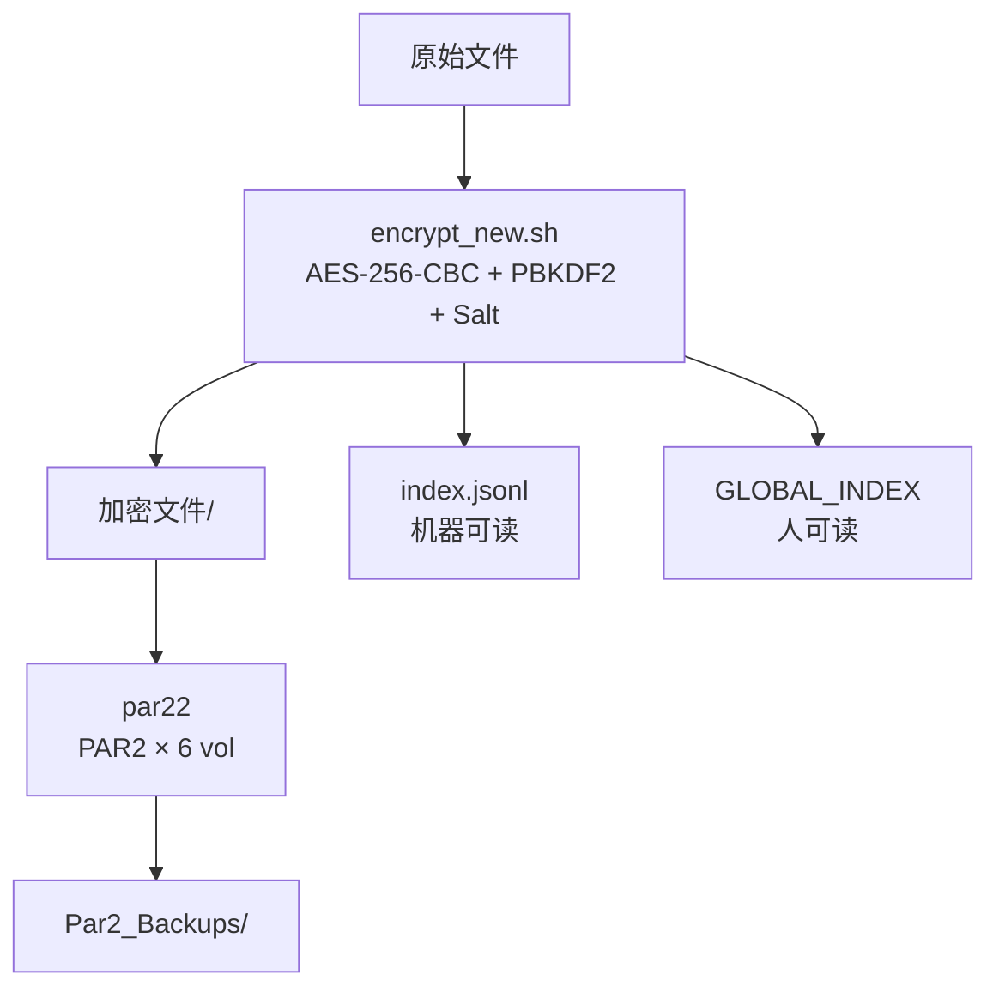

# Privacy-Storage-Toolchain

个人隐私文件的端侧加密与多云盘映射工具链。

纯命令行 + 原生 JS，不依赖任何云服务商 SDK，加密全程在本地完成。

---

## 解决什么问题

把私人文件加密后扔进多个云盘，鸡蛋不放一个篮子；同时保留一份**可读的对照表**，让"原文件名 → 加密文件名"的映射随时能查。

三个约束：
1. **端侧加密**——明文不离开设备
2. **多云盘冗余**——同一份密文映射到多个云盘路径
3. **可恢复**——密文损坏时用 PAR2 校验卷修复

---

## 核心特性

- **端侧加密**：AES-256-CBC + PBKDF2 派生密钥 + 随机 salt
- **双轨索引**：JSONL 给机器读，竖线文本给人看
- **PAR2 容灾**：一次生成 6 个校验卷，路径与源文件一一对应
- **多云盘映射**：加密文件名统一为 basename，与索引第一列对齐（映射器开发中）
- **跨环境**：MT管理器（内置 OpenSSL 3.3.2）负责加密，Termux 负责 PAR2

---

## 架构



---

## 模块

| 模块 | 路径 | 状态 | 说明 |
|------|------|------|------|
| 加密主脚本 | `termux-encrypt/encrypt_new.sh` | ✅ 可用 | AES-256-CBC + PBKDF2，62837 字节 |
| 容灾脚本 | `/sdcard/termux_shared.sh` | ✅ 可用 | `par22` / `fixdat` / `fp` |
| 旧版参考 | `termux-encrypt/encrypt.sh` | 📦 保留 | 含未合并的 `genmap` / `setcloud` |
| 三盘映射器 | `mapping-spa/` | 🚧 开发中 | 计划接入 index.jsonl |
| PAR2 容灾模块 | `par2-recovery/` | 📋 规划 | 目前逻辑在 termux_shared.sh |
| 日记展示层 | `diary-site/` | 📋 规划 | WebView 展示层 |
| 手工原型 | `prototype/映射盘.html` | 🗄 归档 | 早期手工原型 |

---

## 双轨索引

同一批文件，两份索引，各司其职。

### `index.jsonl`（机器读）

路径：`/storage/emulated/0/Documents/Encrypted_Vault/对照表/index.jsonl`

每行一个 JSON 对象：

```json
{"encrypted_name":"enc_1790925335_9217","original_name":"map_test.txt","relative_path":"test_encrypt","cipher":"AES-256-CBC","created_at":"2026-10-02T07:15:35Z","sha256":"7223fe7f...","sizes":{"encrypted":32}}
```

前端读取方式：

```js
const rows = text.split('\n').filter(Boolean).map(JSON.parse);
```

### `GLOBAL_INDEX`（人读）

路径：`/storage/emulated/0/encrypted_index.txt`

竖线分隔，7 列：

```
enc_name | orig_name | rel_path | cloud_name | cloud_path | size | (保留)
```

> 云盘信息目前只在 GLOBAL_INDEX 里，尚未写入 index.jsonl —— 这是前端映射器下一步要补的字段。

---

## 快速开始

### 1. 加密

```bash
cd /目标目录
source ~/Privacy-Storage-Toolchain/termux-encrypt/encrypt_new.sh
ea
```

加密后 `ea` 会显示 `原文件名 → 加密文件名`。

### 2. 生成 PAR2 校验卷

```bash
source /sdcard/termux_shared.sh
par22
```

`par22` 扫描 `ENCRYPT_ROOT`，输出到 `Par2_Backups/`，已存在则跳过。

### 3. 查看索引

```bash
cat /storage/emulated/0/Documents/Encrypted_Vault/对照表/index.jsonl
```

---

## 目录结构

```
Privacy-Storage-Toolchain/
├── diary-site/
├── docs/
├── mapping-spa/
├── par2-recovery/
├── prototype/
├── termux-encrypt/
│   ├── encrypt_new.sh
│   └── encrypt.sh
├── .gitignore
└── README.md
```

数据目录（手机端）：

```
/storage/emulated/0/Documents/Encrypted_Vault/
├── 加密文件/
├── 解密输出/
├── 对照表/
└── Par2_Backups/
```

---

## 技术栈

| 层 | 技术 |
|----|------|
| 脚本 | Bash |
| 加密 | OpenSSL（AES-256-CBC / PBKDF2） |
| 容灾 | PAR2 |
| 前端 | 原生 JS |
| 后端 | Supabase |
| 运行环境 | Termux / MT管理器 |
| 壳 | WebView 或 Termux 本地 HTTP |

> 不做原生 APP。

---

## 状态

- 主链路已闭环：加密 → index.jsonl → PAR2 容灾 → `ea` 显示原名映射
- 全部逻辑真机验证通过
- 下一步：三盘映射器接入 index.jsonl（`mapping-spa/`）

---

## License

MIT